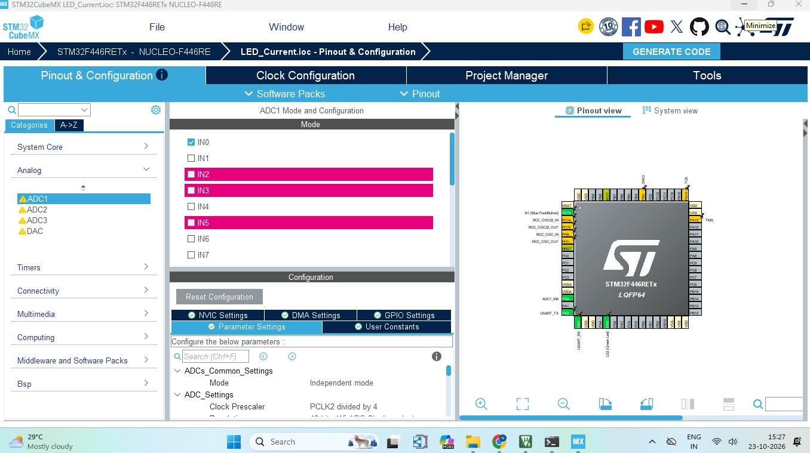
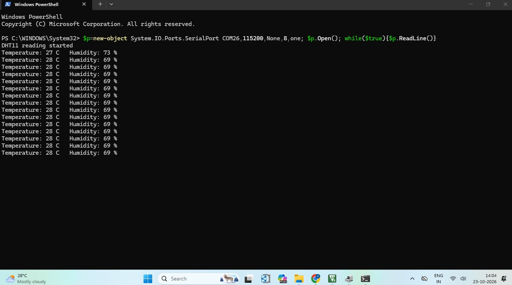

# STM32 DHT11 Temperature and Humidity Monitoring

## Project Overview

This project implements a real-time temperature and humidity monitoring system using the DHT11 sensor and the STM32 NUCLEO-F446RE development board.

STM32CubeMX is used for peripheral configuration, and Keil µVision is used to develop and build the Embedded C firmware. Sensor readings are transmitted to a computer through USART2 serial communication at 115200 baud. The onboard LD2 LED blinks whenever a valid sensor reading is received.

## Hardware and Software Requirements

### Hardware
- STM32 NUCLEO-F446RE development board
- DHT11 temperature and humidity sensor
- Jumper wires
- USB cable for programming and serial communication

### Software
- STM32CubeMX
- Keil µVision
- Windows PowerShell
- Serial terminal support through the ST-LINK virtual COM port

## Pin Configuration

| DHT11 / Board Signal | STM32 NUCLEO-F446RE |
|---|---|
| DHT11 DATA | PA0 |
| DHT11 VCC | 3.3 V or the sensor module's supported supply |
| DHT11 GND | GND |
| Onboard LD2 LED | PA5 |
| USART2 TX | PA2 |
| USART2 RX | PA3 |
| Serial Baud Rate | 115200 |

**Note:** Ensure the DHT11 DATA line has an appropriate pull-up. The exact supply and wiring depend on whether you use a bare DHT11 sensor or a breakout module.

## Project Implementation

### 1. Pinout and GPIO Configuration

The DHT11 DATA pin is connected to PA0, configured for communication with the sensor. PA5 is configured as an output to control the onboard LD2 LED.



### 2. STM32CubeMX Project Manager

The STM32CubeMX project settings are configured to generate the project for the Keil MDK-ARM toolchain.


### 3. Keil µVision Project Window

The generated project is opened in Keil µVision, where the Embedded C firmware is compiled and built.


### 4. PowerShell Serial Output

Windows PowerShell is used to receive and display the temperature and humidity readings transmitted by the STM32 board through USART2.

The firmware sends output in the following format:

```text
DHT11 reading started
Temperature: 28 C   Humidity: 65 %
Temperature: 29 C   Humidity: 64 %
```

*The values above are examples; actual readings depend on the sensor and environment.*

#### PowerShell Command

Use the following command to open the board's serial port and continuously read incoming lines:

```powershell
$p = New-Object System.IO.Ports.SerialPort COM26,115200,None,8,one
$p.Open()
while ($true) { $p.ReadLine() }
```

**Command explanation:**
- `COM26` — COM port assigned to the STM32 board. Replace it with the correct port on your computer.
- `115200` — Serial communication baud rate.
- `None` — No parity.
- `8` — Eight data bits.
- `one` — One stop bit.
- `$p.ReadLine()` — Reads incoming serial data one line at a time.

**Important:** Close any other serial monitor using the same COM port before running the command. The STM32 firmware must transmit UART data at 115200 baud for the readings to appear.



### 5. Hardware Setup and Output

The hardware setup connects the DHT11 sensor to the STM32 NUCLEO-F446RE board. The sensor readings are displayed in PowerShell, and the onboard LD2 LED toggles after each successful reading.


## Key Concepts Learned

- DHT11 temperature and humidity sensing
- GPIO configuration using STM32CubeMX
- Embedded C programming with STM32 HAL
- Sensor communication using precise timing
- USART2 UART serial communication
- Displaying sensor readings through Windows PowerShell
- Onboard LED control using GPIO
- Debugging sensor communication and checksum errors

## Conclusion

This project demonstrates how to interface a DHT11 sensor with an STM32 microcontroller and display environmental readings over UART. It provides practical experience in GPIO configuration, timing-sensitive sensor communication, serial data transmission, and embedded firmware development.

## Future Improvements

- Add an LCD or OLED display for local readings.
- Log sensor measurements to a file.
- Add threshold-based temperature and humidity alerts.
- Implement periodic measurements using hardware timers.
